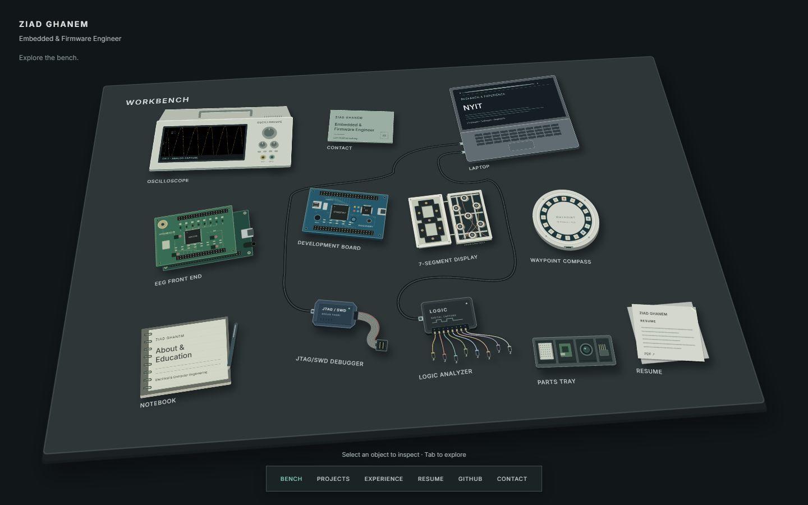

# Ziad Ghanem ? Embedded & Firmware Portfolio

[Live portfolio](https://ziadg.com/) ? [LinkedIn](https://linkedin.com/in/ziad-ghanem/) ? [GitHub](https://github.com/zgeez)

## About

My personal portfolio, presenting embedded systems, firmware, and the software that connects them. I?m Ziad Ghanem, an embedded and firmware engineer based in Brooklyn, NY, with a B.S. in Electrical and Computer Engineering from New York Institute of Technology and ongoing M.S. research in EEG acquisition and neurofeedback.

The site is an interactive lab bench: select equipment to explore projects, debugging stories, experience, skills, and contact details. Nine project case studies document the architecture, implementation, evidence, and limitations behind the work, from an STM32 mixed-signal instrument and ESP32 EEG acquisition to a wireless Pixel Badge.



## Features

- Nine project dossiers with chapter navigation, photographs, diagrams, and recorded demonstrations.
- Interactive signal, timing, navigation, and firmware visualizations.
- Responsive bench and reading layouts, keyboard navigation, and reduced-motion support.
- Static HTML for project narratives and native chapter links, including without JavaScript.
- Static export deployed to GitHub Pages at [ziadg.com](https://ziadg.com/).

Built with **Next.js 15**, **React 18**, **TypeScript**, and **Tailwind CSS**.

## Run locally

Use Node.js 22 or newer and npm. No API keys, environment file, or backend services are required.

```bash
npm ci
npm run dev
```

Open <http://localhost:9002/>. To check and preview the production export:

```bash
npm run check      # TypeScript, lint, and production build
npm start          # http://localhost:4173/
```

The build writes the static site to `portfolio/`. Generated output, dependencies, local configuration, and audit captures are ignored by Git.

## Repository structure

| Path | Contents |
| --- | --- |
| `src/app/` | Routes, metadata, global styles, and the 404 page |
| `src/components/bench/` | Interactive workbench, equipment, and inspection panels |
| `src/components/projects/` | Shared project dossier layout, chapters, and evidence viewer |
| `src/components/portfolio/` | Case studies, diagrams, and interactive technical demonstrations |
| `src/data/` | Project registry, engineering content, profile, and site configuration |
| `public/` | Project media, resume, and custom-domain configuration |
| `scripts/` | Static preview server and browser verification scripts |
| `docs/` | Workbench and project guides, screenshots, and review notes |

Contact links and the canonical domain live in `src/data/site.ts`; profile content lives in `src/data/profile.ts`. Add or update projects in `src/data/projects.ts` and `src/data/project-dossiers.ts`.

## Verification

`npm run check` runs the same typecheck, lint, and build steps used by CI.

The browser suites use Chrome?s debugging protocol and Node?s built-in WebSocket. Start the static preview with `npm start` and a separate headless Chrome instance with `--remote-debugging-port=9333` and a temporary `--user-data-dir`, then run these sequentially:

```bash
node scripts/verify-bench.mjs
node scripts/verify-projects.mjs
node scripts/verify-bench-visuals.mjs
```

`BENCH_ORIGIN` and `BENCH_DEBUGGER` override the default preview and debugger endpoints. Set `BENCH_CAPTURES` and `PROJECT_CAPTURES` to directories under `docs/audit/captures/` to keep new screenshots out of the tracked documentation.

See the [workbench guide](docs/bench/README.md), [project guide](docs/projects/README.md), and [visual review](docs/audit/README.md) for implementation details and existing verification coverage.

## Deployment

[GitHub Actions](.github/workflows/deploy.yml) checks pull requests and pushes to `master`. Successful pushes to `master` publish `portfolio/` to the `gh-pages` branch. The custom domain serves the site at `/`; `public/CNAME` preserves the domain on deployment.

To adapt the site for another domain, update `src/data/site.ts` and `public/CNAME`, and review `next.config.ts` for the intended base path.

## Content and evidence

Project numbers come from the project write-ups, source repositories, or resume. Diagrams and illustrative interactions are distinguished from recorded captures and measured results. Project-specific scope and limitations remain with each case study.

This repository contains the portfolio website. Firmware and application source for the featured projects are linked from their case studies when publicly available.
